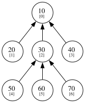
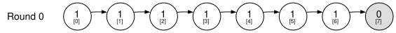
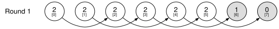
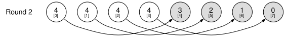
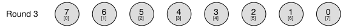
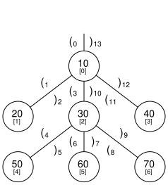

Trees are commonly defined as recursive algebraic data types. In Haskell, you
could define a tree like so:

```
data Tree a = Node a [Tree a]
```

A natural parallel operation on such a tree is mapping a function over its
nodes. It is easy to see how to parallelize this: at each node, fork a thread
for every child to handle that subtree recursively, while the current thread
applies the function to the node’s own value.

```
import Control.Concurrent.Async (concurrently, mapConcurrently)

parMap :: (a -> IO b) -> Tree a -> IO (Tree b)
parMap f (Node x ts) =
  uncurry Node <$> concurrently (f x) (mapConcurrently (parMap f) ts)
```

Throughout this post, we assume that the functions and operators we apply take
constant time. The map then takes $O(n)$ work, since the function is applied
once to each of the $n$ nodes, and $O(d)$ span, where $d$ is the depth of the
tree. The depth appears because a node's thread can only be forked once all of
its ancestors have been forked, so we cannot immediately start working on an
arbitrary node.

The span here is limited by the representation: we can only reach a node by
following pointers from the root, so the depth of the tree ends up on the
critical path. A flatter representation avoids this. Instead of nested lists, we
store the tree as an array of tuples, where the first component is a node’s
value and the second is the index of its parent, with $-1$ marking the root.
Mapping a function over the nodes is then simply a parallel map over the array,
which has work $O(n)$ and span $O(1)$, regardless of the shape of the tree.

This representation can describe malformed trees, so we will assume that every
parent index is in bounds, that there are no cycles, and that exactly one node
is the root. Together these guarantee that every node has a path to the root. We
could also allow for a representation with more roots if we wanted but this
would form a forest instead and may break certain operations you would want.
Anyhow, for this representation we switch to Futhark, a functional language for
data-parallel programming on arrays, which is a natural fit for trees in this
form.

```
type tree [n] 'a = [n](a, i64)

def tree_map [n] 'a 'b (f: a -> b) (t: tree [n] a) : tree [n] b =
  map (\(x, p) -> (f x, p)) t
```

As an example, consider the tree below, where each node shows its value and, in
brackets, its index in the array.



To flatten it, we place each node’s value at its index and use the arrows to
find its parent’s index. Node $[0]$ has no outgoing arrow, so it is the root and
its parent is $-1$. Node $[1]$ points to node $[0]$, so its parent is $0$, and
so on. The full flat representation is:

```
def example : tree [7] i32 =
  [(10, -1), (20, 0), (30, 0), (40, 0), (50, 2), (60, 2), (70, 2)]
```

This representation differs from the Haskell data type in which direction the
pointers go: the Haskell tree tells you each node’s children, while the flat
representation tells you each node’s parent. That makes it a good fit for
data-parallel hardware such as GPUs. Instead of an irregular structure where
each node can have any number of children, every node has exactly one outgoing
pointer, so the tree is just a flat array of fixed-size elements, and a map
distributes the work evenly across threads. The downside is that the
representation is counterintuitive: it is much less obvious how to traverse the
tree from the root downwards, for example to compute the depth of every node. In
the Haskell representation, computing the depth of each node is straightforward:
we pass a depth down the tree, increasing it by one at each level.

```
depths :: Tree a -> Tree Int
depths = go 0
  where
    go d (Node _ ts) = Node d (map (go (d + 1)) ts)
```

This can be parallelized in the same way as the map, forking a thread per child,
which gives $O(n)$ work and $O(d)$ span.

To compute depths in the Futhark representation, we take inspiration from
Wyllie’s list ranking algorithm. List ranking works on the same representation
as our Futhark trees, but with one extra constraint: the tree must form a linked
list, meaning no two nodes share a successor. The algorithm computes each node’s
rank, its distance to the tail of the list. The tail is the node whose successor
is $-1$, which in our trees is the root, so a node’s rank is exactly its depth.

The algorithm maintains one invariant: `rank[i]` is the distance from node $i$
to `succ[i]`. Initially every node points to its parent, so its rank is 1,
except the root, whose rank is 0. Each round is a `step`:

```
def step [n] (rank: [n]i64) (succ: [n]i64) =
  let f i =
    if succ[i] == -1
    then (rank[i], succ[i])
    else (rank[i] + rank[succ[i]], succ[succ[i]])
  in unzip (tabulate n f)
```

If a node’s successor is $-1$, it already points at the tail and its rank is
final. Otherwise, it adds its successor’s rank to its own and jumps its pointer
to its successor’s successor. This preserves the invariant because distances add
up along a path: if $i \to j$ and $j \to k$, pointer jumping replaces them with
an edge $i \to k$, whose distance is the distance of $i \to j$ plus the distance
of $j \to k$. Since every node does this simultaneously, the distance each
pointer covers doubles every round. No node is more than $n - 1$ steps from the
tail, so after $\lceil \log_2 n \rceil$ rounds every pointer has reached it and
every rank is final.

```
def ceil_log2 (n: i64) : i64 =
  if n <= 1 then 0 else 64 - i64.i32 (i64.clz (n - 1))

def depths [n] 'a (t: tree [n] a) : [n]i64 =
  let succ = map (.1) t
  let rank = map (\s -> if s == -1 then 0 else 1) succ
  let (rank, _) =
    loop (rank, succ) for _i < ceil_log2 n do
      step rank succ
  in rank
```

Each round is a single parallel map over all $n$ nodes, so this takes $O(n \log
n)$ work and $O(\log n)$ span. This is not work efficient, but it is a
reasonable price for the amount of parallelism we gain; later we will see a
representation that avoids the extra $\log n$ factor.

We can now draw a step-by-step simulation of Wyllie’s algorithm on a list:






It is tempting to ask whether the algorithm also works on trees. A first
observation is that after round 1, the list has split into two separate lists,
so the algorithm already handles several lists at once. Maybe it can also handle
trees, where several nodes can share a successor.

We can view a tree as a collection of lists: following successors from any node
gives a single path to the root, and paths may merge with each other along the
way. In each step, a node only reads the rank and successor of its own
successor, which lies further up its path. So everything a node ever reads lies
on its path to the root, and it computes exactly the rank it would get from
running Wyllie’s algorithm on that path alone. Where two paths merge, the nodes
they share are only computed once. That is safe because a node’s rank depends
only on its own path, so it is the same no matter which list we view it as part
of. The lists therefore agree on all shared nodes, and every node ends up with
its distance to the root, its depth.

We can generalize this operation to any associative operator. The result is
called a rootfix: every node receives the combination of the values of its
ancestors, accumulated from the root down towards the leaves. The step function
is the same as before, with addition replaced by the operator, and the
ancestor's part placed on the left so the order along each path is preserved.

```
def root_step [n] 'a (op: a -> a -> a) (acc: [n]a) (succ: [n]i64) =
  let f i =
    if succ[i] == -1
    then (acc[i], succ[i])
    else (acc[succ[i]] `op` acc[i], succ[succ[i]])
  in unzip (tabulate n f)

def rootfix [n] 'a (op: a -> a -> a) (ne: a) (t: tree [n] a) : [n]a =
  let (values, succ) = unzip t
  let acc = map (\p -> if p == -1 then ne else values[p]) succ
  let (acc, _) =
    loop (acc, succ) for _i < ceil_log2 n do
      root_step op acc succ
  in acc
```

If we include each node's own value, we get the inclusive rootfix, which does
not need a neutral element, since the root no longer needs a value of its own.

```
def irootfix [n] 'a (op: a -> a -> a) (t: tree [n] a) : [n]a =
  let (acc, succ) = unzip t
  let (acc, _) =
    loop (acc, succ) for _i < ceil_log2 n do
      root_step op acc succ
  in acc
```

An example Blelloch gives in his PhD thesis is passing a flag down to all
descendants of a node, using logical or.

Another common operation on trees is computing subtree sizes, the number of
nodes in the subtree rooted at each node. This is an instance of a leaffix:
every node receives the combination of the values in its subtree, accumulated
from the leaves up towards the root. Once again we take inspiration from
Wyllie's list ranking algorithm, but this time the values flow in the opposite
direction. Instead of each node pulling a value from its successor, each node
pushes its value up to its successor, so values accumulate at the ancestors
rather than the descendants.

This changes what happens when paths merge. In rootfix, several nodes sharing a
successor only meant that they read the same entry, which is harmless. Now they
all write to the same entry, so their values must be combined. We therefore
require the binary operator to be commutative as well as associative, so the
values can be combined in any order, and to have a neutral element. With these
restrictions, we can use a parallel write that combines colliding values with
the operator, which in Futhark is `reduce_by_index`. This gives us both the
inclusive and the exclusive leaffix:

```
def leaf_step [n] 'a (op: a -> a -> a) (ne: a) (acc: [n]a) (succ: [n]i64) =
  let acc' = reduce_by_index (copy acc) op ne succ acc
  let succ' = map (\s -> if s == -1 then -1 else succ[s]) succ
  in (acc', succ')

def ileaffix [n] 'a (op: a -> a -> a) (ne: a) (t: tree [n] a) : [n]a =
  let (acc, succ) = unzip t
  let (acc, _) =
    loop (acc, succ) for _i < ceil_log2 n do
      leaf_step op ne acc succ
  in acc

def leaffix [n] 'a (op: a -> a -> a) (ne: a) (t: tree [n] a) : [n]a =
  let (_, succ) = unzip t
  in reduce_by_index (replicate n ne) op ne succ (ileaffix op ne t)
```

Both take $O(n \log n)$ work. Each round's `reduce_by_index` may have to combine
up to $n$ values into the same index. Futhark's built-in version can take $O(n)$
span in that case, but it can also be implemented with a radix sort followed by
a segmented reduction, which takes $O(\log n)$ span, giving $O(\log^2 n)$ span
in total.

Subtree sizes are then the inclusive leaffix of a tree where every node has the
value one:

```
def subtree_sizes [n] 'a (t: tree [n] a) : [n]i64 =
  ileaffix (+) 0 (map (\(_, p) -> (1, p)) t)
```

On the example tree, this gives `[7, 1, 4, 1, 1, 1, 1]`.

The parent-pointer representation is less intuitive to work with than the
Haskell representation, but it has the benefit that operations on it are easy to
parallelize. It is not the only representation that allows this, though, and
there are two reasons to look for another. First, rootfix and leaffix are not
work efficient: they take $O(n \log n)$ work, whereas the sequential versions
take only $O(n)$. Second, they have poor cache behaviour, since a node’s parent
can be anywhere in the array.

An alternative, described in Blelloch's PhD thesis, is to represent the tree as
a sequence of balanced parentheses, a data structure he calls V-Trees (Vector
Trees). The sequence records a depth-first walk around the tree, an Euler tour:
we write "(" when the walk enters a node and ")" when it leaves it. Each node
thus becomes a matching pair of parentheses, with its descendants nested between
them. As an example, the figure below shows the V-Tree representation of our
example tree. Each edge carries a "(" on its left side and a ")" on its right
side, and each parenthesis is labelled with its position in the sequence. The
two parentheses on a node's incoming edge form a matching pair.



The way you would represent this tree in Futhark is as three arrays, one with
the values of each node, and the remaining arrays both consist of index
positions of parentheses, one for the left ones and one for the right ones.

```
type vtree [n] 'a = {values: [n]a, lp: [n]i64, rp: [n]i64}

def example : vtree [7] i32 =
  { values = [10, 20, 30, 40, 50, 60, 70]
  , lp     = [ 0,  1,  3, 11,  4,  6,  8]
  , rp     = [13,  2, 10, 12,  5,  7,  9]
  }
```

With this representation, rootfix becomes easy. We allocate an array of $2n$
elements and, for each node, place its value at the position of its left
parenthesis and the inverse of its value at the position of its right
parenthesis. An inclusive scan over this array then does all the work.

The key observation is that a right parenthesis cancels out its matching left
parenthesis. In the figure, walking up an edge undoes walking down it, so once
the scan leaves a subtree, that subtree no longer contributes to anything after
it. For example, at position 3, the left parenthesis of node 30, the scan holds
$10 + 20 - 20 + 30 = 40$: the subtree of node 20 has cancelled out, leaving only
node 30 and its ancestor. Reading the scan at each node’s left parenthesis
therefore gives the inclusive rootfix. Reading it at the right parenthesis gives
the exclusive rootfix, since by then the node’s own value has been cancelled as
well.

```
def tour_scan 'a [n] (op: a -> a -> a) (inv: a -> a) (ne: a) ({lp, rp, values}: vtree [n] a) : [2 * n]a =
  scan op ne (scatter (replicate (2 * n) ne) (lp ++ rp) (values ++ map inv values))

def irootfix 'a [n] (op: a -> a -> a) (inv: a -> a) (ne: a) (tree: vtree [n] a) : [n]a =
  let S = tour_scan op inv ne tree
  in map (\i -> S[i]) tree.lp

def rootfix 'a [n] (op: a -> a -> a) (inv: a -> a) (ne: a) (tree: vtree [n] a) : [n]a =
  let S = tour_scan op inv ne tree
  in map (\i -> S[i]) tree.rp
```

A scatter and a scan take $O(n)$ work and $O(\log n)$ span, so unlike the
pointer-jumping version, this is work efficient. The price is that the operator,
together with `ne` and `inv`, must form a group, so that a closed subtree
cancels out. Logical or, from Blelloch's flag example, does not have an inverse,
so it cannot be used here, while the pointer-jumping rootfix handles it fine.

Finally, leaffix. Here we use the nesting of the parentheses: the subtree of a
node is exactly the range between its left and right parenthesis. We place every
node’s value at the position of its left parenthesis in an array of $2n$
elements, fill the rest with the neutral element, and compute an inclusive scan.
At a node’s right parenthesis, the scan holds the combination of every node the
Euler tour has entered so far: the node’s whole subtree, but also its ancestors
and every subtree visited before it. All of that extra lies before the subtree,
so we remove it by combining with the inverse of the scan at the node’s left
parenthesis. Since the scan is inclusive, the value at the left parenthesis also
contains the node itself, so this gives the exclusive leaffix. To get the
inclusive version, we add the node’s own value back.

```
def left_scan 'a [n] (op: a -> a -> a) (ne: a) ({lp, rp = _, values}: vtree [n] a) : [2 * n]a =
  scan op ne (scatter (replicate (2 * n) ne) lp values)

def leaffix 'a [n] (op: a -> a -> a) (inv: a -> a) (ne: a) (tree: vtree [n] a) : [n]a =
  let S = left_scan op ne tree
  in map2 (\l r -> inv S[l] `op` S[r]) tree.lp tree.rp

def ileaffix 'a [n] (op: a -> a -> a) (inv: a -> a) (ne: a) (tree: vtree [n] a) : [n]a =
  map2 op tree.values (leaffix op inv ne tree)
```

Like rootfix, this takes $O(n)$ work and $O(\log n)$ span
and requires the operator to form a group.

You can convert between the two representations, but it is a bit more involved
and would take more time to explain in depth. To convert a pointer `tree` to a
`vtree`, you have to construct an Euler tour, which can be done work efficiently
using radix sorting and list ranking. An implementation of this is found in the
Futhark
[vtree](https://github.com/diku-dk/vtree/blob/main/lib/github.com/diku-dk/vtree/vtree.fut)
library, and the [NESL algorithm
collection](https://www.cs.cmu.edu/~scandal/nesl/algorithms/root.nesl) has an
example of constructing an Euler tour from an edge list. To go the other way,
you compute the depth of every node, list the nodes in preorder, and find for
each node the nearest earlier node with a smaller depth, which is its parent.
This is the [all nearest smaller
values](https://doi.org/10.1145/3626183.3659979) problem. One reason to convert
to the pointer `tree` is that it is easy to build from an edge list. Another is
that its operations never need an inverse: rootfix only needs an associative
operator, and leaffix additionally needs it to be commutative, whereas the
`vtree` versions need the operator to form a group.

With these tools, it is possible to perform many parallel operations on trees,
and rootfix and leaffix are far from the only ones. If you take the time to look
through the Futhark vtree library or Blelloch's thesis, you will find many more.